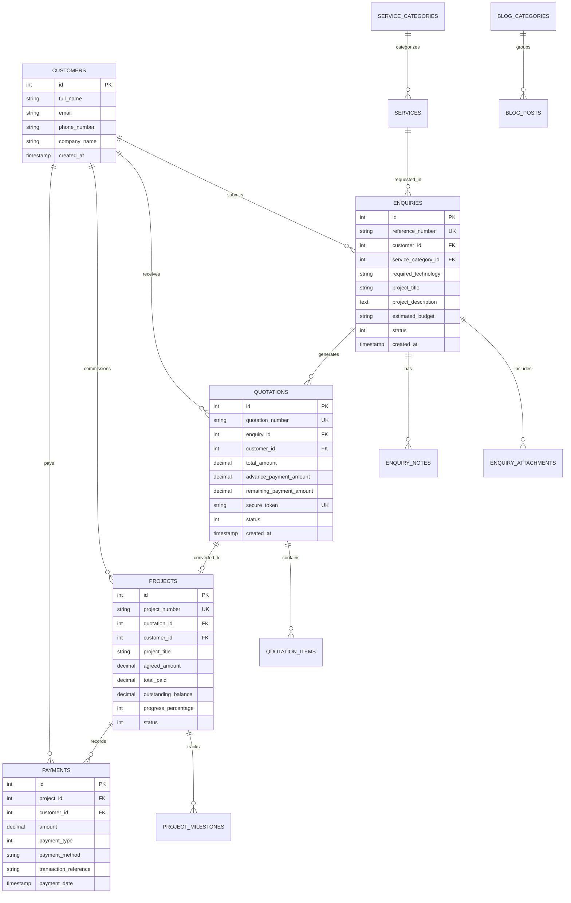

# Database Design & Relational Schema
**PostgreSQL Database Specification for Software Services Platform**

---

## 1. Entity-Relationship (ER) Diagram

---

## 2. Table Catalog & Data Dictionary

### 2.1 Core Business & Lead Tracking

#### `customers`
Stores master profiles of clients, students, and corporate leads. Automatically created or updated when an enquiry is submitted.
| Column | Type | Nullable | Description |
|---|---|---|---|
| `id` | `INTEGER` | No (PK) | Auto-increment primary key |
| `full_name` | `VARCHAR(150)` | No | Customer full name |
| `email` | `VARCHAR(150)` | No | Contact email address (indexed) |
| `phone_number` | `VARCHAR(50)` | No | Phone / WhatsApp number |
| `company_name` | `VARCHAR(150)` | Yes | Organization or university name |
| `address` | `VARCHAR(250)` | Yes | Physical address |
| `notes` | `TEXT` | Yes | Internal CRM notes |
| `created_at` | `TIMESTAMPTZ` | No | Timestamp of creation |
| `is_deleted` | `BOOLEAN` | No | Soft deletion flag |

#### `enquiries`
Tracks service and project quotation requests submitted through public forms.
| Column | Type | Nullable | Description |
|---|---|---|---|
| `id` | `INTEGER` | No (PK) | Auto-increment primary key |
| `reference_number` | `VARCHAR(50)` | No (UK) | Formatted reference (e.g. `ENQ-20261118-A1B2`) |
| `customer_id` | `INTEGER` | No (FK) | Reference to `customers.id` |
| `service_category_id` | `INTEGER` | Yes (FK) | Service category requested |
| `required_technology` | `VARCHAR(100)` | No | Technologies required (e.g., .NET, React, Python) |
| `project_title` | `VARCHAR(200)` | No | Title of the project or problem statement |
| `project_description` | `TEXT` | No | Detailed requirements |
| `estimated_budget` | `VARCHAR(100)` | No | Budget range or expectation |
| `expected_completion_date` | `TIMESTAMPTZ` | Yes | Target delivery deadline |
| `additional_requirements` | `TEXT` | Yes | Extra guidance, IEEE papers, viva prep |
| `status` | `INTEGER` | No | 1=New, 2=Reviewed, 3=Quoted, 4=FollowUp, 5=Converted, 6=Closed, 7=Spam |

#### `enquiry_attachments`
Stores metadata and paths for client documents, IEEE papers, project specs, and error screenshots.
| Column | Type | Nullable | Description |
|---|---|---|---|
| `id` | `INTEGER` | No (PK) | Primary key |
| `enquiry_id` | `INTEGER` | No (FK) | Reference to `enquiries.id` |
| `file_name` | `VARCHAR(250)` | No | Storage file name on disk |
| `original_file_name` | `VARCHAR(250)` | No | Original client upload name |
| `content_type` | `VARCHAR(100)` | No | MIME content type |
| `file_size_bytes` | `BIGINT` | No | Size in bytes |
| `file_path` | `VARCHAR(500)` | No | Absolute local path |

---

### 2.2 Quotation Management

#### `quotations`
Itemized proposals sent to clients with commercial breakdown and digital approval link.
| Column | Type | Nullable | Description |
|---|---|---|---|
| `id` | `INTEGER` | No (PK) | Primary key |
| `quotation_number` | `VARCHAR(50)` | No (UK) | Formal quotation code (e.g. `QT-20261118-XXXX`) |
| `enquiry_id` | `INTEGER` | No (FK) | Linked enquiry record |
| `customer_id` | `INTEGER` | No (FK) | Linked customer record |
| `development_cost` | `DECIMAL(18,2)` | No | Core software engineering fee |
| `additional_cost` | `DECIMAL(18,2)` | No | Setup, documentation, viva mentoring |
| `tax_rate` | `DECIMAL(5,2)` | No | Percentage tax (e.g. 18.00) |
| `tax_amount` | `DECIMAL(18,2)` | No | Calculated tax sum |
| `total_amount` | `DECIMAL(18,2)` | No | Grand total payable |
| `advance_payment_amount` | `DECIMAL(18,2)` | No | Required upfront deposit |
| `remaining_payment_amount` | `DECIMAL(18,2)` | No | Balance due on milestones |
| `expected_delivery_date` | `TIMESTAMPTZ` | No | Delivery target |
| `validity_days` | `INTEGER` | No | Proposal validity duration in days |
| `valid_until` | `TIMESTAMPTZ` | No | Expiration timestamp |
| `secure_token` | `VARCHAR(100)` | No (UK) | Non-guessable token for client public portal |
| `status` | `INTEGER` | No | 1=Draft, 2=Sent, 3=Viewed, 4=Accepted, 5=Rejected, 6=Expired, 7=Cancelled |
| `pdf_path` | `VARCHAR(500)` | Yes | Path to generated QuestPDF proposal document |

#### `quotation_items`
Deliverable line items rendered on quotes and generated PDFs.
| Column | Type | Nullable | Description |
|---|---|---|---|
| `id` | `INTEGER` | No (PK) | Line item ID |
| `quotation_id` | `INTEGER` | No (FK) | Reference to `quotations.id` |
| `title` | `VARCHAR(200)` | No | Deliverable module name |
| `description` | `TEXT` | No | Technical deliverable scope |
| `quantity` | `INTEGER` | No | Units or milestones count |
| `unit_price` | `DECIMAL(18,2)` | No | Rate per unit |
| `total_price` | `DECIMAL(18,2)` | No | Quantity multiplied by unit price |

---

### 2.3 Project Delivery & Financials

#### `projects`
Created when a quotation is accepted. Tracks delivery progress, deadlines, milestones, and billing.
| Column | Type | Nullable | Description |
|---|---|---|---|
| `id` | `INTEGER` | No (PK) | Project primary key |
| `project_number` | `VARCHAR(50)` | No (UK) | Formal code (e.g. `PROJ-20261118-XXXX`) |
| `quotation_id` | `INTEGER` | Yes (FK) | Originating quotation |
| `customer_id` | `INTEGER` | No (FK) | Commissioning customer |
| `project_title` | `VARCHAR(200)` | No | Project headline |
| `agreed_amount` | `DECIMAL(18,2)` | No | Total contract valuation |
| `total_paid` | `DECIMAL(18,2)` | No | Cumulative receipts recorded |
| `outstanding_balance`| `DECIMAL(18,2)` | No | Balance remaining (`agreed_amount - total_paid`) |
| `progress_percentage`| `INTEGER` | No | 0 to 100 delivery progress |
| `status` | `INTEGER` | No | 1=NotStarted, 2=InProgress, 3=OnHold, 4=Completed, 5=Cancelled |

#### `project_milestones`
Itemized deliverables and checkpoints for client sign-off.
| Column | Type | Nullable | Description |
|---|---|---|---|
| `id` | `INTEGER` | No (PK) | Milestone primary key |
| `project_id` | `INTEGER` | No (FK) | Reference to `projects.id` |
| `title` | `VARCHAR(200)` | No | Milestone title |
| `description` | `TEXT` | Yes | Milestone acceptance criteria |
| `due_date` | `TIMESTAMPTZ` | No | Checkpoint deadline |
| `amount` | `DECIMAL(18,2)` | No | Associated invoice amount |
| `is_completed` | `BOOLEAN` | No | Completion flag |

#### `payments`
Ledger of all client deposits, advance payments, milestone settlements, and receipts.
| Column | Type | Nullable | Description |
|---|---|---|---|
| `id` | `INTEGER` | No (PK) | Payment primary key |
| `project_id` | `INTEGER` | No (FK) | Reference to `projects.id` |
| `customer_id` | `INTEGER` | No (FK) | Reference to `customers.id` |
| `amount` | `DECIMAL(18,2)` | No | Amount paid |
| `payment_type` | `INTEGER` | No | 1=Advance, 2=Milestone, 3=Final, 4=Additional |
| `payment_date` | `TIMESTAMPTZ` | No | Date received |
| `payment_method` | `VARCHAR(50)` | No | Bank Transfer, UPI, Card, Stripe, PayPal |
| `transaction_reference` | `VARCHAR(100)` | Yes | Bank UTR / Receipt identifier |

---

### 2.4 Infrastructure & Audit

#### `email_outbox`
Transactional outbox ensuring no emails are lost during network glitches or SMTP downtimes.
| Column | Type | Nullable | Description |
|---|---|---|---|
| `id` | `INTEGER` | No (PK) | Outbox ID |
| `recipient_email` | `VARCHAR(150)` | No | Destination email |
| `subject` | `VARCHAR(250)` | No | Email subject |
| `body` | `TEXT` | No | HTML content |
| `status` | `VARCHAR(50)` | No | `Pending`, `Sent`, `Failed` |
| `retry_count` | `INTEGER` | No | Delivery attempts |
| `error_message` | `TEXT` | Yes | Last exception message |

#### `activity_logs`
Audit trail of administrative actions (login, quotation generation, payment recording).
| Column | Type | Nullable | Description |
|---|---|---|---|
| `id` | `INTEGER` | No (PK) | Log ID |
| `admin_user_id` | `INTEGER` | Yes (FK) | Acting administrator |
| `action` | `VARCHAR(100)` | No | Action type |
| `entity_type` | `VARCHAR(50)` | No | Affected entity (`Quotation`, `Payment`, etc.) |
| `entity_id` | `INTEGER` | Yes | Entity record ID |
| `details` | `TEXT` | Yes | JSON or description of changes |
| `ip_address` | `VARCHAR(50)` | Yes | Client IP address |
