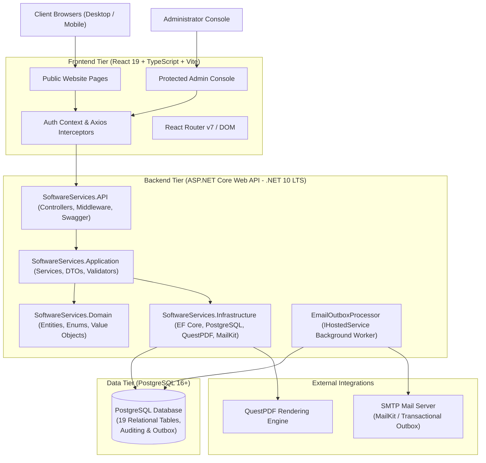

# Project Architecture & System Design
**Full-Stack Software Services Business Platform**

---

## 1. Architectural Overview

The **Software Services Business Platform** is designed as a decoupled, modern enterprise multi-tier architecture adhering to **Clean Architecture** and **Domain-Driven Design (DDD)** principles.



---

## 2. Solution Folder Structure

The project is structured under the root repository into distinct separation of concerns:

```
SoftwareServicesPlatform/
├── Backend/
│   ├── SoftwareServices.API/             # Presentation layer: Controllers, Middleware, Auth Setup, DI
│   ├── SoftwareServices.Application/     # Application use-cases, DTOs, Business Interfaces, Validation
│   ├── SoftwareServices.Domain/          # Core Domain entities, Enums, Domain Rules, BaseEntity
│   ├── SoftwareServices.Infrastructure/  # EF Core DbContext, Npgsql, Repositories, PDF & Email Services
│   ├── SoftwareServices.Tests/           # Unit tests (xUnit, Moq, FluentAssertions)
│   └── SoftwareServices.sln              # Visual Studio / dotnet Solution
├── Frontend/
│   └── software-services-ui/             # React 19, TypeScript, Vite, Tailwind CSS v4, Lucide Icons
├── Database/
│   ├── 01_CreateDatabase.sql             # SQL script for database creation
│   ├── 02_CreateTables.sql               # All 19 relational tables, PKs, FKs, EF migration sync
│   ├── 03_SeedData.sql                   # Initial admin user, categories, services, portfolio, blog
│   ├── 04_IndexesAndConstraints.sql      # Unique indexes, performance indexes, partial filters
│   └── README.md                         # Database execution guide for pgAdmin
└── Documentation/
    ├── ProjectArchitecture.md            # System architecture, layer responsibilities, design patterns
    ├── DatabaseDesign.md                 # Entity relationship diagram and table dictionaries
    ├── API_Documentation.md              # REST API catalog, endpoints, schemas, authentication
    ├── SetupInstructions.md              # Local installation and development setup guide
    ├── DeploymentGuide.md                # Production Docker, Linux systemd, Nginx, and cloud hosting
    └── README.md                         # Documentation index
```

---

## 3. Layer Responsibilities & Patterns

### A. SoftwareServices.Domain
- Pure C# class library with zero third-party framework dependencies.
- Contains all **Domain Entities** inheriting from `BaseEntity` (providing `Id`, `CreatedAt`, `UpdatedAt`, `IsDeleted`, and `DeletedAt`).
- Enums: `EnquiryStatus`, `QuotationStatus`, `ProjectStatus`, `PaymentType`, `PaymentStatus`.

### B. SoftwareServices.Application
- Implements use cases and business workflows:
  - `IEnquiryService` & `EnquiryService`: Handles public quotation submissions, reference number generation (`ENQ-YYYYMMDD-XXXX`), customer upsertion, and outbox notification queuing.
  - `IQuotationService` & `QuotationService`: Quotation creation, itemized calculation (development + additional cost + tax - advance = remaining), secure token generation (`Guid.NewGuid().ToString("N")`), approval/rejection lifecycle.
  - `IProjectService` & `ProjectService`: Conversion of accepted quotations to projects (`PROJ-YYYYMMDD-XXXX`), milestone checklist tracking, progress percentage calculation.
  - `IPaymentService` & `PaymentService`: Financial receipt logging, project balance updates (`totalPaid`, `outstandingBalance`), transaction reference tracking.
  - `IDashboardService` & `DashboardService`: Analytics aggregation (enquiries, conversion rate, project velocity, financial revenue).
  - `IAuthService` & `AuthService`: PBKDF2 password verification, admin role authorization.
  - `IContentService` & `ContentService`: Catalog management for services, portfolio showcases, technical articles, and testimonials.

### C. SoftwareServices.Infrastructure
- **Entity Framework Core 10** with `Npgsql.EntityFrameworkCore.PostgreSQL`.
- Configured decimal precisions (`decimal(18,2)`) across all monetary columns.
- Soft delete global query filters (`!e.IsDeleted`).
- **Transactional Outbox Email Service**:
  - Enquiries and quotations add pending email records to the `email_outbox` table within the same transaction.
  - `EmailOutboxProcessor` (`IHostedService` BackgroundService) polls the outbox, sends emails via MailKit, marks status, or safely logs payload in development if no SMTP host is configured.
- **QuestPDF Document Generation**:
  - `PdfQuotationGenerator` produces itemized, commercial-grade quotation proposals with customer headers, item tables, financial totals, terms, and digital approval links.

### D. SoftwareServices.API
- RESTful HTTP controllers with standard route versioning (`/api/...` and `/api/admin/...`).
- Centralized `ExceptionHandlingMiddleware` transforming uncaught exceptions into standardized `ApiResponse<T>`.
- JWT Bearer Authentication scheme (`[Authorize]`) with configurable secret and token expiration.
- Swagger / OpenAPI documentation with Bearer token authorization header integration.

---

## 4. Security Architecture

1. **Authentication & Session:**
   - Stateless JWT tokens signed with HMAC-SHA256.
   - Protected admin routes guarded via `[Authorize]`.
   - Passwords hashed using PBKDF2 with HMAC-SHA256, 100,000 iterations, and cryptographic salt. Plain-text passwords are never stored.

2. **Public Enquiries & Quotations:**
   - Public customer submissions require **no login**, lowering friction for leads.
   - Customer approval/rejection of quotations is authenticated via cryptographically strong, non-guessable **secure tokens** (`/quote/{secureToken}`).
   - Public users can never mutate financial amounts or terms; they can only accept or reject with remarks.

3. **Data Protection & Sanitization:**
   - Input validation handled via FluentValidation rules.
   - Entity Framework Core uses parameterized queries by default, protecting against SQL injection.
   - Uploaded files are restricted by extension (`.pdf`, `.doc`, `.docx`, `.zip`, `.txt`, `.png`, `.jpg`) and size (10 MB maximum), stored safely outside web roots.
